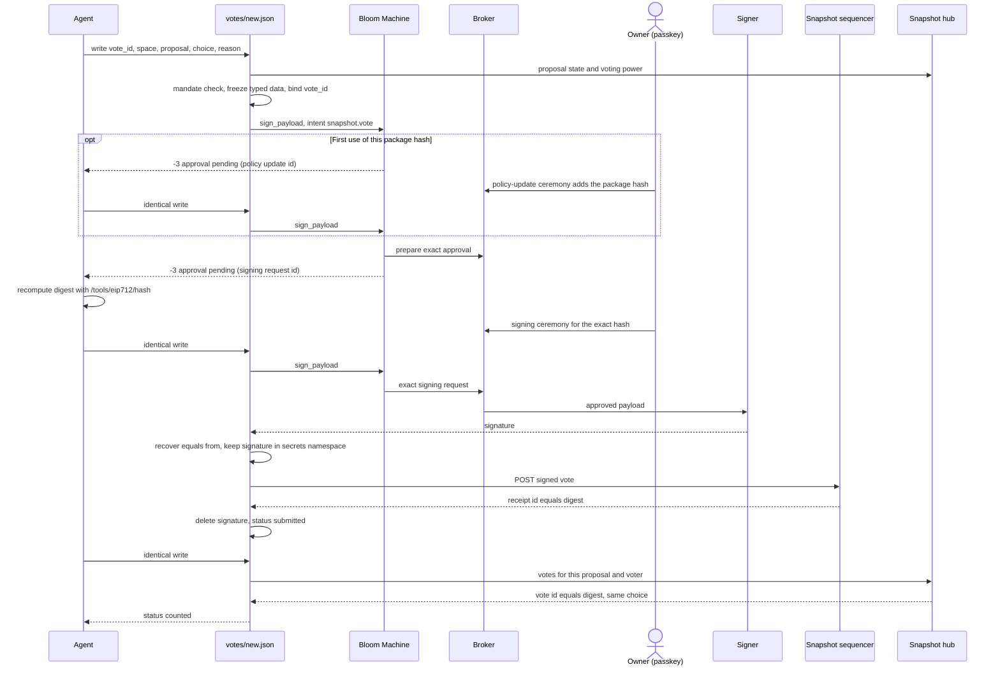

# ballot

A Bloom Petal that lets an agent read Snapshot proposals and draft gasless
votes that Bloom signs only after the wallet owner approves each one.

Demo video: https://youtu.be/wdwTPIZ1NGw?si=SVlnOsPbbNNJngxj

**Status:** `v0.1.0` ([release](https://github.com/AlejoPH03/bloom-petal-ballot/releases/tag/v0.1.0)). Reads work on testnet and mainnet. Votes work on
Snapshot testnet only and passed a live acceptance and a dress rehearsal
([evidence](docs/evidence/README.md)). Mainnet voting ships off by default; it’s a one-line, owner-approved change.

## Motivation

Most DAO token holders do not vote, because reading proposals and voting takes
time. An agent could do that work, but giving an agent a key means it can sign
anything. Core Bloom deliberately refuses to be that signing oracle:
`wallets/<w>/sign/*` is rejected
(`legacy_wallet_sign_surface_is_absent`, `crates/bloom-vfs/src/handlers/wallets.rs:7850`
at Bloom `433a0daf`), so it will not sign arbitrary EIP-712. `ballot` turns one
protocol's typed-data signature, a Snapshot vote, into a named, reviewable,
policy-bound operation: the intent `snapshot.vote`. The agent does the reading
and drafts the vote. The owner approves that exact vote with a passkey and can
check what is being signed with Bloom's own tool, so the holder hands over the
work and keeps the authority. Votes are gasless, so the full authority path (policy, approval, signing, submission, counting) runs
without moving funds.

## Use cases

1. **Vote with reasoning.** `votes/new.json` takes a `reason` of up to 500 characters, signed and published with the vote.
2. **Never miss a deadline.** `inbox.json` lists open proposals and raises `closing_soon` for an unvoted proposal with under 24 h left.
3. **Follow a delegate.** `following.json` offers a ready vote body for each open proposal the delegate voted on and you have not. Nothing votes automatically.
4. **Stay inside a mandate.** `mandate.json` holds allowed spaces, blocked keywords, a required reason and a daily limit.
5. **Change your mind.** Write the new choice under a new `vote_id`, with a new ceremony. A newer hub vote is detected (`live.superseded_hint`), but re-voting is not a separate flow, the `superseded` status is never set in this build, and it was not run live.

## Using ballot with an agent

The Petal's interface is its files. An agent lists, reads and writes paths under
`/petals/ballot`, and starts from the contract Bloom serves at
`/petals/ballot/AGENTS.md`. There is no separate API. The commands elsewhere in
this README are what an agent runs, or what a developer uses to test.
[`docs/agent-setup/CLAUDE.md`](docs/agent-setup/CLAUDE.md) sets up a Claude Code
session as a governance agent. An example, following the
[demo video](https://youtu.be/wdwTPIZ1NGw?si=SVlnOsPbbNNJngxj) (illustrative, not a transcript):

> **You:** What needs my attention in governance?
>
> **Agent:** "Lower protocol fee to 0.2%" is open and you haven't voted. Your delegate voted For.
>
> **You:** Vote with my delegate on the fee proposal: For, using the suggested reason.
>
> **Agent:** Drafted: "Lower protocol fee to 0.2%", For, reason "Following 0x042a…a596", digest `0x2f93fa716ab03eb953e536bc12acad11f957f3a5a27c4908a5ee8e20f41e6d3f`. Bloom first needs you to add this build to the wallet's policy. The ceremony link is on your clipboard. Please open it in your browser.
>
> **You:** Approved.
>
> **Agent:** Now the signing request for this exact vote. Bloom's own tool recomputed the digest and it matches: `0x2f93fa716ab03eb953e536bc12acad11f957f3a5a27c4908a5ee8e20f41e6d3f`. Compare it with the hash on the ceremony page. The link is on your clipboard.
>
> **You:** Approved.
>
> **Agent:** Submitted. Snapshot's receipt equals the digest. It isn't counted yet.
>
> **You:** Is it counted?
>
> **Agent:** Yes. The record says `counted`, and the hub shows a vote with that id and choice.
>
> **You:** Also vote For on the treasury transfer, reason "fund the grants".
>
> **Agent:** Your mandate refused it (blocked keyword "treasury transfer"). Nothing was bound and no ceremony opened. I won't change the mandate unless you ask.

## How it works

All paths are under `/petals/ballot/`. `<a>` is
`<network>/accounts/<wallet>/<n>`, and `<network>` is `testnet` or `mainnet`.
Full contract: [AGENTS.md](AGENTS.md).

| Path | Access | What it does | Capabilities |
| --- | --- | --- | --- |
| `status.json` | read | Petal name, version, sign intent, Snapshot endpoints | none |
| `<network>/spaces/<space>/proposals.json` | read | A space's active and 10 most recent proposals | http |
| `<network>/proposals/<id>.json` | read | One proposal, with `vote_type_supported` and `voting_open` | http |
| `<a>/inbox.json` | read | Open proposals in mandate spaces, whether this account voted, alerts | http, store, vfs.read |
| `<a>/following.json` | read | Proposals a followed delegate voted on, each with a ready body | http, store, vfs.read |
| `<a>/mandate.json` | read, write | The owner's standing rules | store |
| `<a>/votes/` | read | `new.json` plus one record per vote | store |
| `<a>/votes/new.json` | read, write | Checks, freezes, signs (owner approval) and submits a vote | http, sign, store, vfs.read |
| `<a>/votes/<vote_id>.json` | read | The vote's state, typed data, digest, verify commands, receipt | http, store |

The remaining directory routes only list children and import nothing.



## Verify without trusting Ballot

Snapshot's vote id is the EIP-712 digest Bloom signs (`docs/plan-votes.md` §0),
so one value links the readable vote to the result. The values below are from
the dress rehearsal, [`rehearsal-follow-vote.json`](docs/evidence/rehearsal-follow-vote.json).

| Link | Value | Where it is recorded |
| --- | --- | --- |
| Readable vote | `bloom-ballot-182c.eth`, proposal `0xcba6d117…b63b`, choice 1, reason `Following 0x042a…a596` | `.typed_data.message` |
| Ballot's digest | `0x88ad93684270db0d5562cf607c55723209b543fd5090537c5cb278baae909f9a` | `.digest`, `.verify.expected_out_hex` |
| Bloom's `/tools/eip712/hash` | must equal the digest | `out.hex`, not saved as a file: run it below |
| Ceremony page | the same hash, without `0x` | `exact_ordered_hashes` on the page, not saved as a file |
| Snapshot's receipt | `0x88ad93684270db0d5562cf607c55723209b543fd5090537c5cb278baae909f9a` | `.receipt.id` |
| Hub's vote id | `0x88ad93684270db0d5562cf607c55723209b543fd5090537c5cb278baae909f9a` | `.counted.hub_vote_id`, `.live.hub_vote.id` |

Recompute the digest with Bloom's tool, which hashes with alloy
(`bloom-vfs/src/handlers/tools.rs:539-545`). This needs a Bloom node but not
Ballot:

```sh
jq -c .typed_data docs/evidence/rehearsal-follow-vote.json | bloom vfs write /tools/eip712/hash/check/in.json
bloom vfs cat /tools/eip712/hash/check/out.hex
```

Check the vote on the hub without Bloom:

```sh
curl -s https://testnet.hub.snapshot.org/graphql -H 'content-type: application/json' \
  -d '{"query":"{vote(id:\"0x88ad93684270db0d5562cf607c55723209b543fd5090537c5cb278baae909f9a\"){id voter choice reason}}"}'
```

**What does not work yet.** At these Bloom versions the owner's ceremony shows
only the digest, not the vote's fields, so the owner must run the check above
before approving. Broker master already has a generic EIP-712 review (commit
`e2f55a7`, #103, `crates/bloom-broker/src/message_review.rs`), which our pin
`76bb7e0` does not contain. To use it, Machine would have to send
`message_review_payloads` for Petal classes. At our pin it does not: it reduces
the Petal's `action` bytes to a digest. Ballot already builds the full typed
data and passes it as `action` (`route/src/votes/host.rs:181`). Details:
[known-limitations §1](docs/known-limitations.md) and the
[draft upstream issue](docs/upstream-issue-draft.md).

## Lifecycle

| Status | Meaning |
| --- | --- |
| `refused` | A check failed. Nothing is bound, and the `vote_id` can be reused. |
| `drafted`, `awaiting_approval` | Typed data and timestamp are frozen. Waiting for the owner. |
| `signed` | Signature held in the secrets namespace, normally for one step. |
| `submitted` | The sequencer accepted the vote. `receipt.id` equals the digest. |
| `counted` | The hub shows a vote with that id and choice. |
| `expired`, `rejected_by_snapshot` | Final. |

**Identical retry.** Every step after the first is the same write again. The
same `vote_id` with the same space, proposal, choice and reason resumes from the
current state, never re-signs with a different timestamp and never submits
twice. A different body under a bound `vote_id` is refused.

**Expiry.** An expired vote stays expired (`approval_expired`,
`proposal_closed`, or `timestamp_stale` after 6 days). To vote again, write it
under a new `vote_id`, which freezes a new timestamp and opens a new ceremony.

## Mandate

The mandate is **advisory**: the Petal stores it and the agent can edit it, so
it is not a security boundary. It filters drafts before the owner is asked,
with `mandate_*` refusals that bind nothing and open no ceremony. Every vote
still needs the owner's approval. An owner-signed, binding mandate is future
work ([plan](docs/plan-mandate-inbox.md)).

## Security and least authority

Each route imports only what it uses, confirmed with `wasm-tools component wit`
on the built components:

| Route | `http` | `store` | `vfs.read` | `sign` |
| --- | :-: | :-: | :-: | :-: |
| `votes/new.json` | yes | yes | yes | yes |
| `inbox.json`, `following.json` | yes | yes | yes | |
| `votes/<vote_id>.json` | yes | yes | | |
| `votes/` (listing), `mandate.json` | | yes | | |
| `proposals.json`, `proposals/<id>.json` | yes | | | |
| `status.json`, other directories | | | | |

- **Network.** `petal.toml` allows only `POST` to `testnet.hub.snapshot.org/graphql`, `hub.snapshot.org/graphql` and `testnet.seq.snapshot.org/`.
- **Signing.** `[sign].allowed_intents` is only `snapshot.vote`. `approval_hint` is never passed.
- **Secrets.** A signature exists only in the store's `secrets` namespace between signing and submission, then is deleted. Reads show at most `signature_sha256`.
- **Leak check.** `scripts/leak-check.sh` fails on any run of 130 or more hex digits in tracked files or build output, outside a commented list of public values.
- **No path dispatch.** One handler per route file, enforced by `scripts/check-route-architecture.sh`.

**Mainnet votes** are refused (`mainnet_disabled`) before any external call,
because a mainnet vote spends real governance power and this build is tested
only on testnet. To enable them, an owner makes two deliberate changes in their
own commit:

1. Add to `petal.toml`:

   ```toml
   [[net.allow]]
   binding = "mainnet-sequencer"
   host = "seq.snapshot.org"
   methods = ["post"]
   paths = ["/"]
   ```

2. Remove the `Network::Mainnet` gate at the top of `draft()` in `route/src/votes/flow.rs`, and its test `mainnet_is_refused_before_any_external_call`.

Both change the package hash, so the build then needs provenance enrollment, a
triad restart and the owner's policy-update ceremony.

## Testing

```sh
cargo test --manifest-path route/Cargo.toml
bash scripts/check-route-architecture.sh
petal build --root . && petal check --root .
bash scripts/leak-check.sh
```

- **132 host tests**, including golden vectors for the EIP-712 digest and the sequencer envelope (`docs/snapshot-testnet/golden/`, built offline), the state machine against fakes (`route/src/votes/flow_tests.rs`, 37 tests), and crash injection at every store write (`crash_at_any_store_write_converges`).
- **Live acceptance, 2026-11-07:** vote `accept-1` reached `counted`, with refusals and a conflict checked ([accept-1](docs/evidence/accept-1.json), [closed-1](docs/evidence/closed-1.json), [marker](docs/evidence/votes-new-marker.json)).
- **Dress rehearsal, 2026-11-09:** followed a delegate through both ceremonies to `counted` ([vote](docs/evidence/rehearsal-follow-vote.json)), and a blocked proposal was refused ([refusal](docs/evidence/rehearsal-treasury-refused.json)).
- **Agent rehearsal, 2026-11-09:** the governance agent's For vote from the Bloom account shows on testnet.snapshot.box ([screenshot](docs/evidence/snapshot-vote.png)).
- **Demo vote, 2026-11-11:** the recorded demo voted on "Lower protocol fee to 0.2%" after a policy-update ceremony ([screenshot](docs/evidence/policy-ceremony.png)) and a signing ceremony. Digest `0x2f93fa716ab03eb953e536bc12acad11f957f3a5a27c4908a5ee8e20f41e6d3f`, equal to Snapshot's vote id on the hub.

Runbook: [`scripts/rehearse.md`](scripts/rehearse.md). Index:
[`docs/evidence/README.md`](docs/evidence/README.md).

## Tested host combination

| Component | Version |
| --- | --- |
| Bloom (Machine) | `433a0daf7ef7457a33a31fb4436c910f6c877bf0` |
| bloom-broker | `76bb7e0956089df44a9b39ca41d1b07497c3ec59` (Bloom's pin) |
| bloom-signer | `3f880d7b96ebcc18f07afadac6f07c7f7036e90c` (Bloom's pin) |
| petal SDK and CLI | `ba76944a20248493858bfbc2c5f86e3d859f719a` |
| Route contract | `bloom:route@0.1.0`, WIT digest `f52579e1f964eb0302c418f08817593d8f2fc38a434b5f71b483972c56839254` |
| Host | Windows 11, WSL2, Ubuntu 24.04 ([setup notes](docs/dev-setup-wsl.md)) |
| Network | Snapshot testnet |

## Installing

Every path gives all the read routes. **Signing is separate**: `votes/new.json`
also needs installer provenance for that exact package hash and the owner's
approval. If a different build is installed, run `bloom petals uninstall ballot`
first. Never use `--force`.

**Release archive (for reviewers):** from the
[v0.1.0 release](https://github.com/AlejoPH03/bloom-petal-ballot/releases/tag/v0.1.0):

```sh
gh release download v0.1.0 -R AlejoPH03/bloom-petal-ballot
sha256sum -c SHA256SUMS
bloom petals install ./ballot-v0.1.0.petal.tar.gz
```

The release also carries `petal-release.json`, with the archive's `sha256` and
its `package_hash`. That `package_hash` is the hash an owner's catalog would pin
for this archive ([§10](docs/known-limitations.md)).

**Local checkout:**

```sh
bash scripts/build.sh
bloom petals build . && bloom petals install .
```

Bloom hashes every file under the root except `.git` and `target`, including
git-ignored files, so remove what should not ship.

**GitHub source:**

```sh
bloom petals install https://github.com/AlejoPH03/bloom-petal-ballot --ref v0.1.0
```

This is **refused at our Bloom pin**: `unsupported GitHub owner AlejoPH03;
trusted owner is bloom-directory` ([§9](docs/known-limitations.md)). The package
is ready for it (`[source]`, `[build]` and `scripts/build.sh`). If the
repository moves, set `[source].repository` to the new name. A source build has
a new hash per checkout, so it cannot be enrolled for signing in advance.

**Signing votes.** Without provenance for the exact hash, reads work and
`votes/new.json` is refused with a bare permission error. With it, the first
signing attempt opens a policy-update ceremony. On a developer triad the owner
enrolls and installs the **same directory**. The command exists only in the
`triad-dev-harness` build of `bloom`:

```sh
mkdir ballot-pkg && tar -xzf ballot-v0.1.0.petal.tar.gz -C ballot-pkg
"$BLOOM_BIN" init triad-enroll-developer-petal-provenance "$BLOOM_TRIAD_DEVELOPER_ROOT/config" ballot-pkg
# restart the triad, then:
bloom petals uninstall ballot   # only if another build is installed
bloom petals install ballot-pkg
```

Do not enroll the extracted tree and then install the `.petal.tar.gz`: their
hashes differ ([§10](docs/known-limitations.md)). For a checkout,
`bash scripts/dev-cycle.sh` does all of this. On a packaged Bloom an owner
cannot enroll a package. Its catalog has to pin the hash that
`bloom petals install <archive>` reports.

## Known limitations

From [docs/known-limitations.md](docs/known-limitations.md):

- The ceremony shows only the digest (§1).
- Every rebuild, including a docs-only one, is a new package hash that needs enrollment, a triad restart and a policy ceremony (§3, §5), and loses in-flight votes (§8).
- Signing denials reach the route as bare denials, so `approval_expired` is inferred (§7).
- A vote must reach Snapshot within 6 days of being drafted (§6).
- GitHub URL installs are refused outside `bloom-directory` (§9).
- Only `single-choice` and `basic` proposals can be voted on.

## Roadmap

- Readable ceremony review through upstream Broker's message review.
- An owner-signed, binding mandate.
- More vote types.
- Mainnet as an explicit owner opt-in.
- Hosting under `bloom-directory`, so URL installs work.
